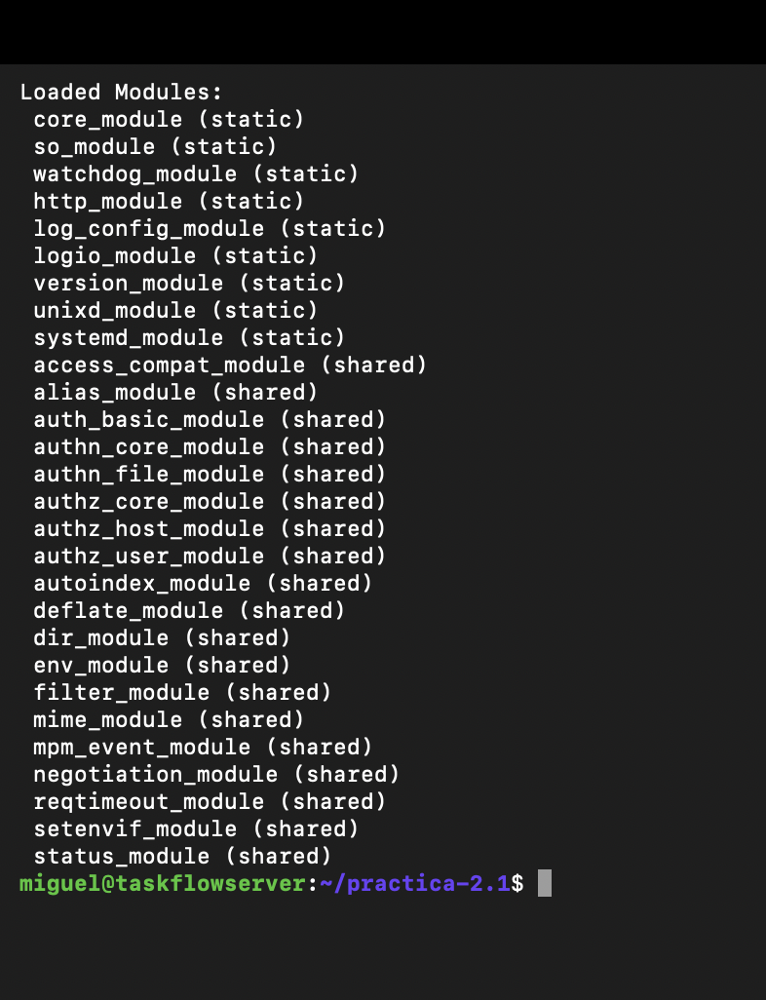
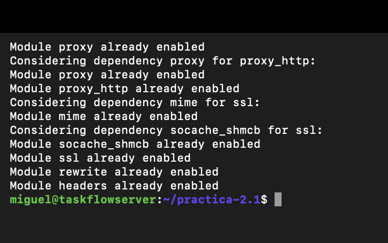
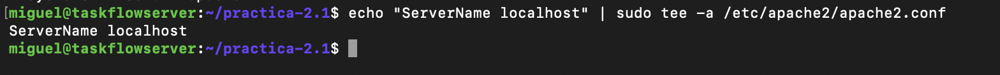
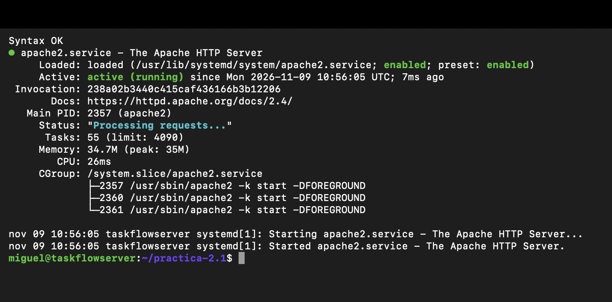
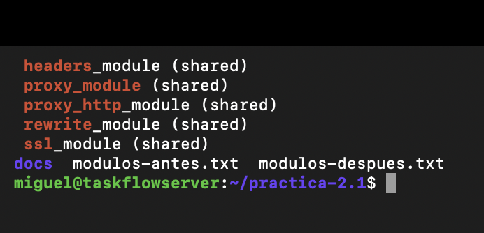

# Práctica 2.1 — Módulos de Apache

**Alumno:** Miguel Luzón Prado · **Módulo:** Despliegue de Aplicaciones Web (2º DAW) · **Proyecto:** TaskFlow

**Objetivo:** activar los módulos de Apache necesarios para el proyecto.

**Entorno:** Ubuntu Server 26.10 (ARM64) en VMware Fusion, servidor `taskflowserver`, administrado por SSH desde el Mac (`ssh miguel@172.16.121.133`). Apache 2.4.

---

## 1. ¿Qué es un módulo de Apache?

Apache es **modular**: el núcleo del servidor hace lo básico y cada funcionalidad extra (proxy, cifrado, reescritura de URLs, cabeceras…) va en un **módulo** que se activa solo si hace falta. Así Apache solo carga lo que se usa, gasta menos recursos y tiene menos superficie de ataque.

Los módulos se organizan igual que los sitios:

| Carpeta | Contenido |
|---|---|
| `/etc/apache2/mods-available/` | Todos los módulos instalados (disponibles, pero no activos) |
| `/etc/apache2/mods-enabled/` | Los módulos **activos**: enlaces simbólicos a `mods-available` |

Por eso **hay que activarlos**: un módulo instalado pero no activado no se carga, y si una configuración usa sus directivas (por ejemplo `ProxyPass` sin `proxy`), Apache da error y no arranca. Se activan con `a2enmod`, igual que los sitios se activan con `a2ensite`.

---

## 2. Listar los módulos activos

```bash
apache2ctl -M
```

Salida antes de activar nada:

```
Loaded Modules:
 core_module (static)
 so_module (static)
 watchdog_module (static)
 http_module (static)
 log_config_module (static)
 logio_module (static)
 version_module (static)
 unixd_module (static)
 systemd_module (static)
 access_compat_module (shared)
 alias_module (shared)
 auth_basic_module (shared)
 authn_core_module (shared)
 authn_file_module (shared)
 authz_core_module (shared)
 authz_host_module (shared)
 authz_user_module (shared)
 autoindex_module (shared)
 deflate_module (shared)
 dir_module (shared)
 env_module (shared)
 filter_module (shared)
 mime_module (shared)
 mpm_event_module (shared)
 negotiation_module (shared)
 reqtimeout_module (shared)
 setenvif_module (shared)
 status_module (shared)
```

- `(static)`: módulo compilado dentro de Apache, siempre presente.
- `(shared)`: módulo cargado desde `mods-enabled`, se puede activar o desactivar.

Los 5 módulos de la práctica (`proxy`, `proxy_http`, `ssl`, `rewrite`, `headers`) **no aparecen** todavía.

Lista completa guardada como entregable:

```bash
apache2ctl -M > modulos-antes.txt
```



---

## 3. Activar los módulos

```bash
sudo a2enmod proxy proxy_http ssl rewrite headers
```

```
Enabling module proxy.
Considering dependency proxy for proxy_http:
Module proxy already enabled
Enabling module proxy_http.
Considering dependency mime for ssl:
Module mime already enabled
Considering dependency socache_shmcb for ssl:
Enabling module socache_shmcb.
Enabling module ssl.
Enabling module rewrite.
Enabling module headers.
To activate the new configuration, you need to run:
  service apache2 restart
```

`a2enmod` también activa solo las **dependencias**: `proxy_http` necesita `proxy`, y `ssl` necesita `mime` y `socache_shmcb` (caché de sesiones SSL).

Al volver a ejecutar el comando con los módulos ya activos, `a2enmod` responde `already enabled` para cada uno (y para sus dependencias), lo que confirma que quedaron activados:



---

## 4. Reiniciar y verificar

### Comprobar la configuración y reiniciar

```bash
sudo apachectl configtest
sudo systemctl restart apache2
sudo systemctl status apache2
```

`configtest` debe devolver `Syntax OK` y `status` debe mostrar `active (running)`.

### Reinicio sin warnings

Al reiniciar puede salir este aviso:

```
AH00558: apache2: Could not reliably determine the server's fully qualified domain name, using 127.0.0.1. Set the 'ServerName' directive globally to suppress this message
```

No es un error, pero significa que falta la directiva **`ServerName`** (el nombre DNS del servidor) en `apache2.conf`. Se añade al final del fichero:

```bash
echo "ServerName localhost" | sudo tee -a /etc/apache2/apache2.conf
sudo apachectl configtest      # Syntax OK, ya sin el aviso
sudo systemctl restart apache2
```



Resultado: `Syntax OK` sin el aviso `AH00558`, y el servicio `active (running)` y `enabled` (arranca solo al iniciar el servidor):



### Verificación filtrada

En lugar de leer toda la lista, se filtra con `grep` para ver solo los 5 módulos:

```bash
apache2ctl -M | grep -E "proxy_module|proxy_http|ssl|rewrite|headers"
```

```
 headers_module (shared)
 proxy_module (shared)
 proxy_http_module (shared)
 rewrite_module (shared)
 ssl_module (shared)
```

Los 5 módulos están activos. Lista completa después de activarlos (en la captura, el `ls` muestra los dos ficheros de la lista de módulos):

```bash
apache2ctl -M > modulos-despues.txt
```



---

## 5. Para qué sirve cada módulo

| Módulo | Para qué sirve | Uso en TaskFlow |
|---|---|---|
| `proxy` | Activa la función de **proxy** de Apache: recibir una petición y reenviarla a otro servidor. Es la base; por sí solo no sabe hablar ningún protocolo | Necesario para que Apache haga de proxy inverso delante del backend |
| `proxy_http` | Añade a `proxy` el soporte para reenviar peticiones por **HTTP** | Reenviar las peticiones a Gunicorn / al contenedor en `127.0.0.1:8000` |
| `ssl` | Permite servir **HTTPS** (puerto 443) cifrando la conexión con SSL/TLS y certificados | Que la web vaya cifrada |
| `rewrite` | **Reescribe o redirige URLs** según reglas | Redirigir todo lo que llegue por HTTP (80) a HTTPS (443) |
| `headers` | Permite **añadir, cambiar o quitar cabeceras** HTTP de peticiones y respuestas | Añadir cabeceras de seguridad a las respuestas |

---

## 6. Ejemplos de configuración

Ejemplo de host virtual que usa los 5 módulos a la vez (fichero en `sites-available`):

```apache
# Puerto 80: todo se redirige a HTTPS  → rewrite
<VirtualHost *:80>
    ServerName taskflow.local
    RewriteEngine On
    RewriteRule ^/(.*)$ https://%{HTTP_HOST}/$1 [R=301,L]
</VirtualHost>

# Puerto 443: HTTPS + proxy hacia Gunicorn
<VirtualHost *:443>
    ServerName taskflow.local

    # ssl
    SSLEngine on
    SSLCertificateFile /etc/ssl/certs/ssl-cert-snakeoil.pem
    SSLCertificateKeyFile /etc/ssl/private/ssl-cert-snakeoil.key

    # proxy + proxy_http
    ProxyPass / http://127.0.0.1:8000/
    ProxyPassReverse / http://127.0.0.1:8000/

    # headers
    Header set X-Frame-Options "DENY"
</VirtualHost>
```

| Directiva | Módulo | Qué hace |
|---|---|---|
| `RewriteEngine On` | rewrite | Activa el motor de reescritura en ese host |
| `RewriteRule ^/(.*)$ https://%{HTTP_HOST}/$1 [R=301,L]` | rewrite | Redirige cualquier URL a la misma por HTTPS. `R=301` = redirección permanente; `L` = última regla |
| `SSLEngine on` | ssl | Activa SSL/TLS en ese host |
| `SSLCertificateFile` / `SSLCertificateKeyFile` | ssl | Certificado y clave privada. Los *snakeoil* son certificados de prueba autofirmados que trae Ubuntu |
| `ProxyPass / http://127.0.0.1:8000/` | proxy + proxy_http | Reenvía las peticiones al backend |
| `ProxyPassReverse / http://127.0.0.1:8000/` | proxy | Corrige las cabeceras de las respuestas del backend para que apunten al dominio público |
| `Header set X-Frame-Options "DENY"` | headers | Añade una cabecera a la respuesta (aquí, prohíbe mostrar la web dentro de un iframe de otra página) |

Comprobado con `apachectl configtest` → `Syntax OK`. Sin los módulos activados, estas directivas darían error de sintaxis.

---

## 7. Otros módulos relevantes

| Módulo | Para qué sirve |
|---|---|
| `deflate` | Comprime las respuestas (gzip) para que pesen menos. Viene activo por defecto |
| `proxy_balancer` | Reparte las peticiones entre varios servidores backend (balanceo de carga) |
| `expires` | Indica al navegador cuánto tiempo guardar en caché los ficheros estáticos |

---

## 8. Criterios de aceptación

- [x] Los 5 módulos activos (`proxy`, `proxy_http`, `ssl`, `rewrite`, `headers`).
- [x] Apache reinicia sin errores (y sin warnings tras añadir `ServerName`).
- [x] Documentado el propósito de cada módulo, con ejemplos de configuración.
