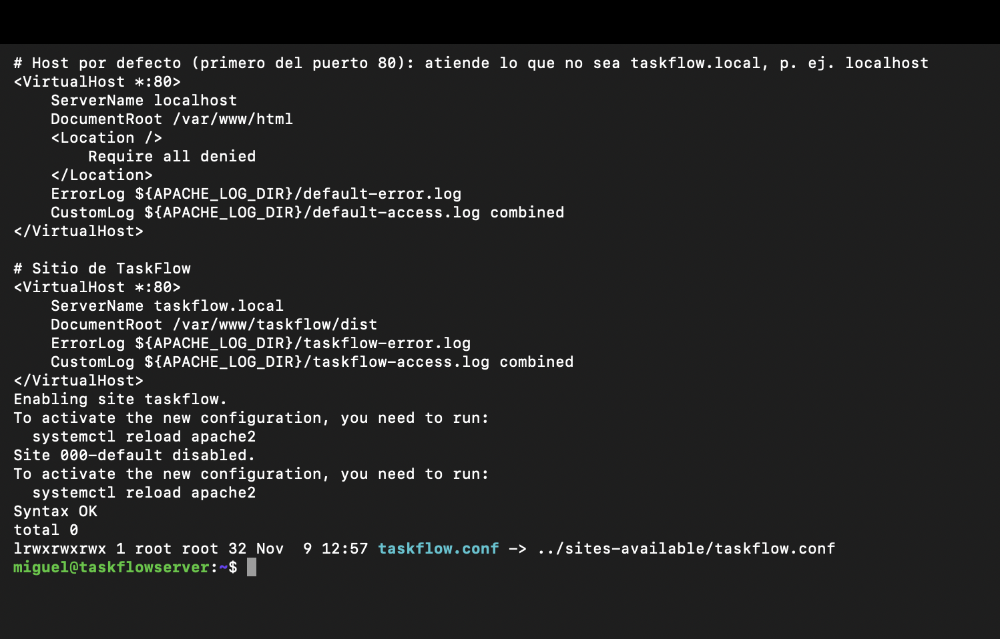
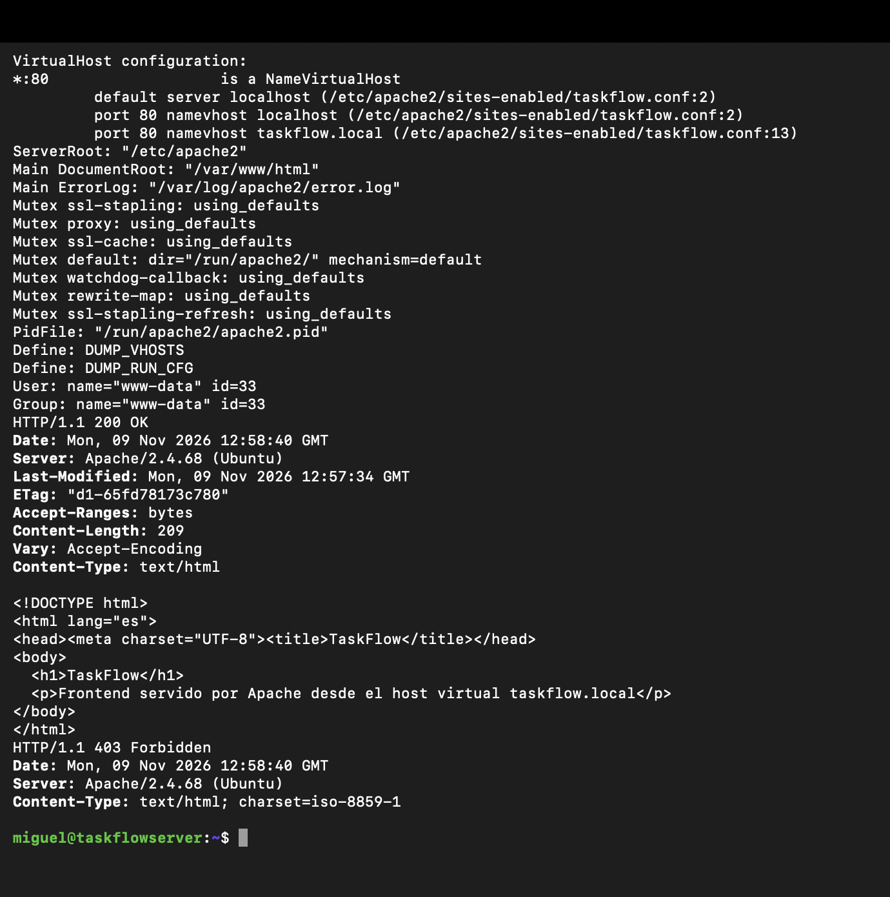
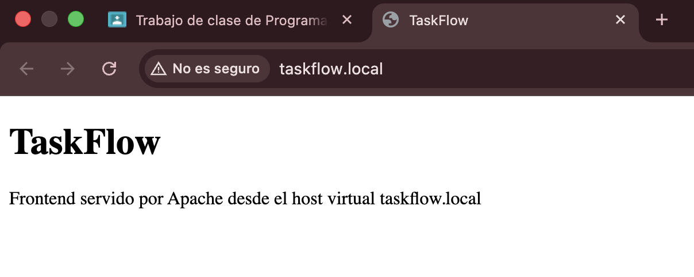
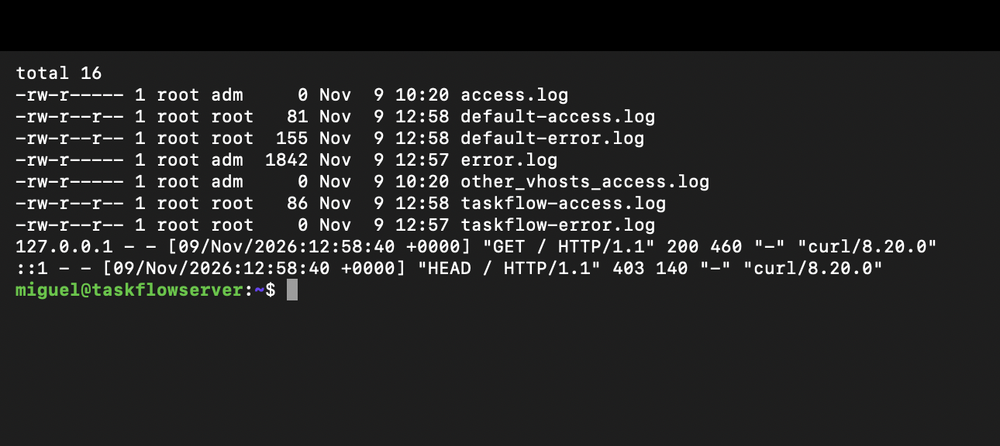

# Práctica 2.2 — Host virtual `taskflow.local`

**Alumno:** Miguel Luzón Prado · **Módulo:** Despliegue de Aplicaciones Web (2º DAW) · **Proyecto:** TaskFlow

**Objetivo:** crear un sitio dedicado con logs separados.

**Entorno:** Ubuntu Server 26.10 en VMware Fusion (`taskflowserver`, IP 172.16.121.133), Apache 2.4.68, administrado por SSH desde el Mac.

---

## 1. Conceptos

- **VirtualHost:** bloque de configuración que define un sitio web dentro de Apache. Permite servir varios sitios distintos desde el mismo servidor y la misma IP.
- **ServerName:** nombre de dominio al que responde el VirtualHost.
- **DocumentRoot:** carpeta de la que el VirtualHost sirve los ficheros.
- **Cómo decide Apache qué VirtualHost usar:** mira la cabecera `Host` de la petición HTTP (el dominio que escribió el navegador) y busca el VirtualHost de ese puerto cuyo `ServerName` coincida. Si ninguno coincide, usa el **primer VirtualHost definido** para ese puerto (el *default server*).
- **Casos de uso:** varios dominios en un mismo servidor (`taskflow.local`, `api.taskflow.local`, otra web…), y separar entornos (`dev.taskflow.local` para desarrollo y `taskflow.local` para producción), cada uno con su carpeta y sus logs.

---

## 2. Build del frontend

El frontend de TaskFlow todavía no está desarrollado, así que el "build" es un `index.html` en `/var/www/taskflow/dist`, la carpeta donde irá el build real (al generarlo, basta con copiar sus ficheros ahí).

```bash
sudo mkdir -p /var/www/taskflow/dist
sudo tee /var/www/taskflow/dist/index.html > /dev/null <<'HTML'
<!DOCTYPE html>
<html lang="es">
<head><meta charset="UTF-8"><title>TaskFlow</title></head>
<body>
  <h1>TaskFlow</h1>
  <p>Frontend servido por Apache desde el host virtual taskflow.local</p>
</body>
</html>
HTML
```

---

## 3. `/etc/apache2/sites-available/taskflow.conf`

```apache
# Host por defecto (primero del puerto 80): atiende lo que no sea taskflow.local, p. ej. localhost
<VirtualHost *:80>
    ServerName localhost
    DocumentRoot /var/www/html
    <Location />
        Require all denied
    </Location>
    ErrorLog ${APACHE_LOG_DIR}/default-error.log
    CustomLog ${APACHE_LOG_DIR}/default-access.log combined
</VirtualHost>

# Sitio de TaskFlow
<VirtualHost *:80>
    ServerName taskflow.local
    DocumentRoot /var/www/taskflow/dist
    ErrorLog ${APACHE_LOG_DIR}/taskflow-error.log
    CustomLog ${APACHE_LOG_DIR}/taskflow-access.log combined
</VirtualHost>
```

| Directiva | Función |
|---|---|
| `<VirtualHost *:80>` | Sitio que escucha en el puerto 80 de todas las IPs |
| `ServerName taskflow.local` | Dominio al que responde el sitio |
| `DocumentRoot /var/www/taskflow/dist` | Carpeta del build del frontend |
| `ErrorLog` | Fichero de log de errores propio del sitio |
| `CustomLog ... combined` | Fichero de log de accesos propio del sitio, en formato `combined` |
| `${APACHE_LOG_DIR}` | Variable de `envvars` = `/var/log/apache2` |

**Por qué hay un primer VirtualHost:** al desactivar `000-default`, si solo existiera el de `taskflow.local`, sería el *default server* y Apache lo serviría para **cualquier** dominio, también para `localhost`. Por eso el primer bloque recoge todo lo que no sea `taskflow.local` y lo deniega (`Require all denied` → 403), con sus propios logs. Así `localhost` no muestra el contenido de `taskflow.local`.

---

## 4. Activar el sitio y desactivar el por defecto

```bash
sudo a2ensite taskflow.conf
sudo a2dissite 000-default.conf
sudo apachectl configtest
sudo systemctl reload apache2
ls -l /etc/apache2/sites-enabled/
```

En `sites-enabled` solo queda el enlace a `taskflow.conf`:



---

## 5. `/etc/hosts`

En el servidor:

```bash
echo "127.0.0.1 taskflow.local" | sudo tee -a /etc/hosts
```

En el Mac (para abrirlo desde el navegador del anfitrión):

```bash
echo "172.16.121.133 taskflow.local" | sudo tee -a /etc/hosts
```

---

## 6. Verificación

```bash
sudo apache2ctl -S
curl -i http://taskflow.local
curl -I http://localhost
```



- `apache2ctl -S`: el puerto 80 tiene dos VirtualHosts; `localhost` es el *default server* (`taskflow.conf:2`) y `taskflow.local` está en `taskflow.conf:13`. **ServerName y DocumentRoot verificados.**
- `http://taskflow.local` → `200 OK` con el HTML del frontend de TaskFlow.
- `http://localhost` → `403 Forbidden`: no muestra el contenido de `taskflow.local`.

Desde el navegador del Mac:



---

## 7. Logs separados

```bash
ls -l /var/log/apache2/
sudo tail -n 3 /var/log/apache2/taskflow-access.log
sudo tail -n 3 /var/log/apache2/default-access.log
```



Cada VirtualHost genera sus propios ficheros (`taskflow-access.log`, `taskflow-error.log`, `default-access.log`, `default-error.log`), separados del `access.log` / `error.log` generales:

- `taskflow-access.log`: `"GET / HTTP/1.1" 200` → la petición a `taskflow.local`.
- `default-access.log`: `"HEAD / HTTP/1.1" 403` → la petición a `localhost`.

---

## 8. Cómo añadir otro host

Ejemplo, un entorno de desarrollo `dev.taskflow.local`:

1. Crear su carpeta y contenido: `sudo mkdir -p /var/www/taskflow-dev/dist`.
2. Crear `/etc/apache2/sites-available/taskflow-dev.conf`:

   ```apache
   <VirtualHost *:80>
       ServerName dev.taskflow.local
       DocumentRoot /var/www/taskflow-dev/dist
       ErrorLog ${APACHE_LOG_DIR}/taskflow-dev-error.log
       CustomLog ${APACHE_LOG_DIR}/taskflow-dev-access.log combined
   </VirtualHost>
   ```
3. Activarlo y recargar: `sudo a2ensite taskflow-dev.conf && sudo systemctl reload apache2`.
4. Añadirlo a `/etc/hosts`: `127.0.0.1 dev.taskflow.local`.

---

## 9. Criterios de aceptación

- [x] `taskflow.local` sirve correctamente el frontend.
- [x] Los logs son independientes del resto de sitios.
- [x] `localhost` no muestra el contenido de `taskflow.local` (403).
